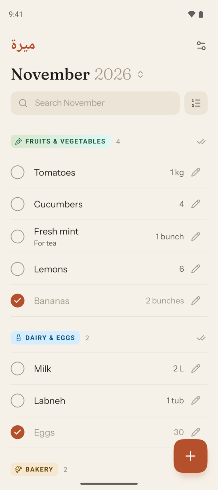
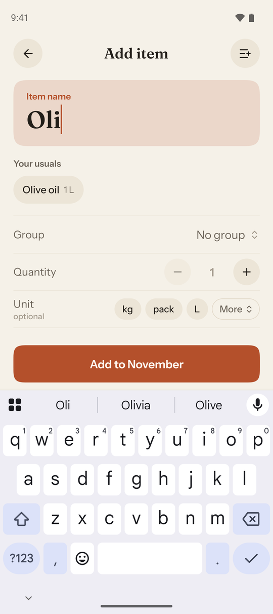
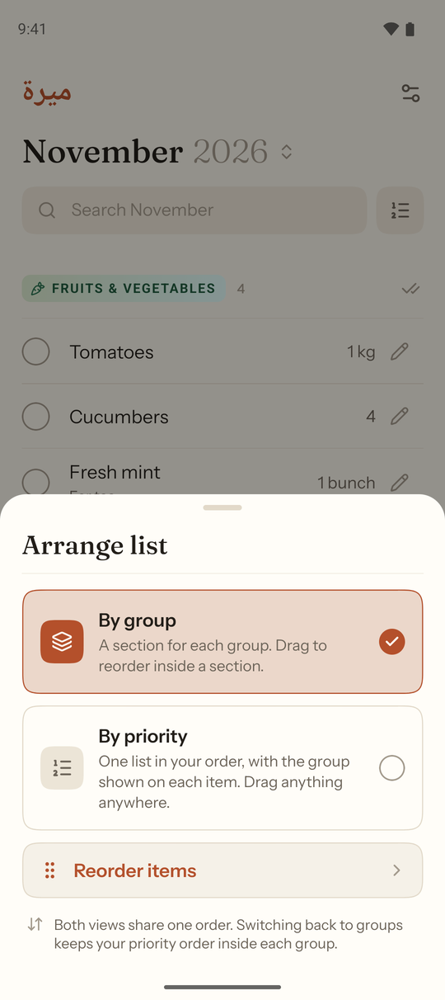
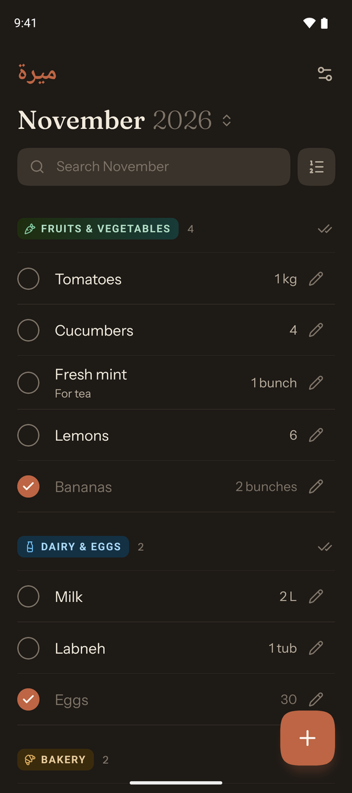
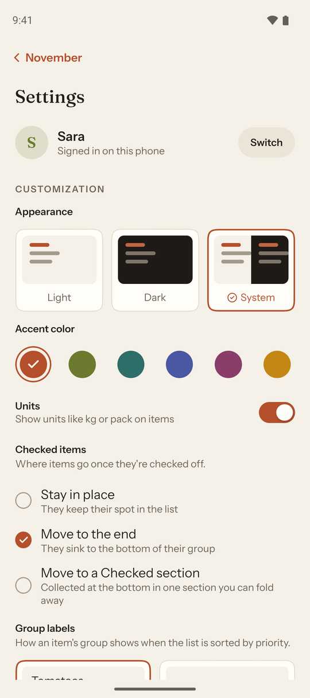
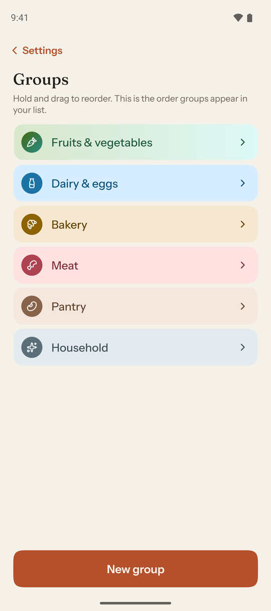

# Mira (ميرة)

A self-hosted, offline-first household grocery list. One list per month, shared live between everyone in the house. The list works fully offline and syncs when the server is reachable.

<p align="center">
  
  
  
  
</p>
<p align="center">
  
  
</p>

```
apps/mobile    Expo app (iOS, Android, and the web PWA from the same code)
apps/server    Node sync server: TinyBase WebSocket sync + SQLite, also serves the PWA
packages/shared  Data model, month logic, rollover, list view, auth protocol (used by both)
deploy/        Quadlet (Podman) and systemd user unit
Containerfile, compose.yaml   Container image for Docker or Podman
```

## How it works

- Every device holds the whole household in a TinyBase `MergeableStore` (a CRDT). Native devices persist it to SQLite (`expo-sqlite`); the PWA uses IndexedDB. Edits apply locally first, so the app never waits on the network.
- The server is another peer. It keeps the canonical copy in SQLite (`node:sqlite`) and relays changes between devices over one WebSocket path, `/sync`.
- **Auth.** The household password is checked on the WebSocket upgrade, before TinyBase sees the socket. A wrong password gets a 401 and no socket. Browsers can't set headers on WebSockets, so the password travels as a second `Sec-WebSocket-Protocol` entry; native clients use the same mechanism. `POST /api/auth/check` backs the login screen. Repeated failures from one address are rate limited.
- **Profiles, not accounts.** Login is server, then password, then pick or create a profile. All three are cached on the device (Keychain/Keystore via `expo-secure-store`; `localStorage` on web).
- **Rollover.** When a month opens, unchecked items from the latest earlier month that had groceries are copied in. Each copy's ID is `hash(source item id + month)`, so two offline phones produce identical rows that merge cleanly. A copy is never re-created, so deleting a carried item sticks. The "since Oct" tag is derived from `added_at`.
- **Offline.** Local edits made while disconnected are tracked per row. The header shows "Offline · N to sync" and each affected row shows a small cloud icon until the next successful sync.

## Develop

```sh
pnpm install
pnpm test                       # shared + server tests
pnpm typecheck

# server (dev): password via env
MIRA_PASSWORD=dev pnpm --filter @mira/server dev

# app: needs a development build (native modules), not Expo Go
cd apps/mobile
npx expo run:android            # or run:ios, or: npx eas-cli build --profile development
npx expo start --dev-client
npx expo start --web            # PWA in the browser
```

## Deploy the server

All options run the same image. It serves the sync endpoint and the PWA on port 8787, and stores data in `/data`.

**Bazzite / Fedora Atomic (rootless Podman + Quadlet, recommended).** No rpm-ostree layering needed. See the header of `deploy/quadlet/mira.container`:

```sh
podman build -t mira-server -f Containerfile .
printf '%s' 'household-password' | podman secret create mira-password -
cp deploy/quadlet/mira.container ~/.config/containers/systemd/
systemctl --user daemon-reload && systemctl --user start mira
loginctl enable-linger "$USER"
sudo firewall-cmd --permanent --add-port=8787/tcp && sudo firewall-cmd --reload
```

**Docker (or `podman compose`).**

```sh
printf '%s' 'household-password' > deploy/password.txt
docker compose up -d --build
```

**No container.** `deploy/systemd/mira.service` runs the bundled `server.mjs` under a systemd user unit. It needs Node ≥ 22.13 on the host.

**HTTPS.** Plain `http://` works for the native apps on your LAN, but browsers only install the PWA and run it offline over HTTPS. Put Caddy or `tailscale serve` in front for that. Over plain HTTP the household password is also sent unencrypted on your network.

**Backups, HTTPS setups and restoring:** see [docs/self-hosting.md](docs/self-hosting.md).

## OTA updates

`expo-updates` is built in, with a fingerprint runtime version, so JS-only changes can ship without a rebuild. Before the first build, choose where updates come from:

- **EAS Update:** `npx eas-cli init && npx eas-cli update:configure`, then `eas update --channel production`.
- **Self-hosted:** point `updates.url` at a server that speaks the Expo Updates protocol.

Either way, the update URL is baked into the binary, so pick before building.

Native modules are included up front so later features don't need a rebuild: SQLite, secure store, crypto, haptics, Reanimated, Gesture Handler, keyboard controller, bottom sheet, reorderable list, SVG, network state, quick actions (home-screen "Add item"), keep-awake, sharing and localization.
